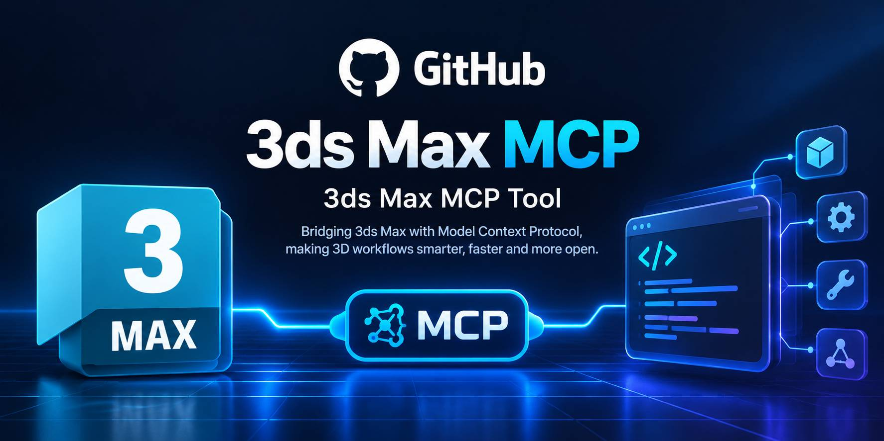

# 3dsmax-mcp



**Let AI agents work directly with Autodesk 3ds Max — modeling, materials, rigging, animation, rendering, baking, and asset export.**

An MCP (Model Context Protocol) server and in-process MAXScript bridge for connecting AI clients to 3ds Max.

[English](README.md) · [简体中文](README.zh-CN.md)

---

## Quick Start & Installation

### 1. Install the 3ds Max Bridge & Server (PowerShell)

```powershell
git clone https://github.com/vino3dx/3dsmax-mcp.git
cd 3dsmax-mcp
python scripts/install.py --yes
```

> **Important:** Restart **3ds Max** after installation so its startup script loads the MAXScript bridge.

### 2. Configure Your AI Client (`mcp.json`)

Add `3dsmax-mcp` to your MCP client configuration (Cursor, Claude Desktop, Windsurf, Cline, WorkBuddy, etc.):

**Option A — via `npx` (Recommended):**

```json
{
  "mcpServers": {
    "3dsmax-mcp": {
      "command": "npx",
      "args": ["-y", "vino-3dsmax-mcp"]
    }
  }
}
```

**Option B — via local Python:**

```json
{
  "mcpServers": {
    "3dsmax-mcp": {
      "command": "python",
      "args": ["-m", "maxmcp.server"],
      "env": {
        "PYTHONPATH": "C:\\path\\to\\3dsmax-mcp\\src\\python"
      }
    }
  }
}
```

---

## Overview

3dsmax-mcp connects an MCP-compatible AI client to a running 3ds Max instance. It exposes structured tools for inspecting and editing scenes, while the MAXScript bridge performs operations inside 3ds Max.

The system has two main parts:

| Component | Runs in | Responsibility |
| --- | --- | --- |
| MCP server | Separate Python process | Handles MCP / JSON-RPC requests, tool discovery, configuration, and client communication |
| MAXScript bridge | Inside 3ds Max | Receives commands over local TCP and executes scene operations on Max's main thread |

Typical request flow:

```text
AI client
   │ MCP (stdio or HTTP)
   ▼
Python MCP server
   │ TCP / newline-delimited JSON
   ▼
MAXScript bridge in 3ds Max
   │
   ▼
3ds Max scene
```

The project is intended for CG, game art, animation, and content-pipeline workflows. Actual capability and reliability depend on the individual tool and the 3ds Max version; not every registered tool should be assumed to have identical live-test coverage.

## Why a MAXScript bridge?

3dsmax-mcp uses MAXScript as its in-process execution layer rather than depending on pymxs for its core bridge.

- The Python MCP server runs independently of the Python version embedded in a particular 3ds Max release.
- Scene commands are dispatched through a timer-driven bridge on the 3ds Max main thread.
- The bridge can expose MAXScript functionality through a consistent MCP interface.

The trade-off is that MAXScript has language and runtime constraints. The project therefore includes its own JSON handling and conventions. See [Bridge conventions](docs/BRIDGE_CONVENTIONS.md).

## Architecture and transports

The Python server supports these client-facing transports:

- **stdio** — the MCP client launches the local server process.
- **Streamable HTTP** — `POST /mcp`.
- **Legacy HTTP + SSE** — `GET /sse` and the associated message endpoint.

The Python server communicates with the Max-side bridge over TCP, normally at `127.0.0.1:8765`. The bridge processes newline-delimited JSON messages and dispatches them to registered MAXScript handlers.

The repository also contains context tracking, event/revision reporting, tool profiles, bilingual tool descriptions, and image content conversion for Vision responses. Refer to the source and tests for the exact behavior of each feature.

## Compatibility

The repository documents the following intended environment:

| Component | Documented range / mode |
| --- | --- |
| 3ds Max | 2020–2027+ (64-bit; verify the specific release in your environment) |
| Operating system | Windows 10 / 11 |
| Python server | Python 3.8+; standard-library runtime |
| MCP transports | stdio, Streamable HTTP, legacy HTTP + SSE |
| Bridge | Local TCP, default port 8765 |

The project's primary implementation is Windows-specific. Compatibility statements are not a substitute for testing against your exact 3ds Max release and installation.

## Quick start

### 1. Install the bridge and server

From the repository directory:

```bash
python scripts/install.py --yes
```

The installer detects 3ds Max user script locations, deploys the MAXScript bridge and Python server, and can register supported MCP clients.

Useful installer commands:

```bash
python scripts/install.py --list
python scripts/install.py --client print
python scripts/install.py --client workbuddy cursor cline --yes
python scripts/install.py --port 9000 --language en --profile modeling
python scripts/install.py --http-port 8770
python scripts/install.py --uninstall
```

**After installation, restart 3ds Max** so its startup script can load the bridge. If you update an existing installation, run the installer again to refresh deployed files, then restart Max.

### 2. Check the installation

Run:

```bash
python scripts/doctor.py
```

The diagnostic script checks the Python environment, deployed files, detected 3ds Max installations, bridge connectivity, and supported client registrations. A running 3ds Max instance is required for a successful live bridge handshake.

### 3. Connect an MCP client

The installer can register supported clients automatically. To print a configuration snippet without changing a client configuration:

```bash
python scripts/install.py --client print
```

For a manually configured stdio client, the general configuration shape is:

```json
{
  "mcpServers": {
    "3dsmax-mcp": {
      "command": "python",
      "args": ["-m", "maxmcp", "--port", "8765", "--language", "auto"]
    }
  }
}
```

Use the actual Python executable and installed package path from your machine. Restart or reload the MCP client after changing its configuration.

## Using it with AI

Once connected, ask the agent to perform a specific task and let it inspect the scene before making changes. For example:

- "List the objects in the current scene and report their types and polygon counts."
- "Create a box, add a TurboSmooth modifier, and verify the modifier settings."
- "Assign a material to the selected objects and show me a viewport capture."
- "Export the selected assets as FBX to the project's export directory."

For production work, ask the agent to verify important changes by reading the resulting scene state. A successful tool response alone is not sufficient proof that every requested property was applied.

## Tool coverage

The current GitHub README/catalog snapshot reports **419 tools across 9 categories**. Treat this as a repository snapshot, not as a guarantee that every tool has passed live validation. You can inspect the tool list exposed by your installed version:

```bash
python -m maxmcp --list-tools
python -m maxmcp --list-profiles
```

| Category | Reported tools | Main areas |
| --- | ---: | --- |
| `system` | 34 | Bridge status, diagnostics, execution utilities, undo-related controls, units and time |
| `scene` | 19 | Scene operations, layers, assets, missing-texture relinking |
| `files` | 9 | File and directory operations |
| `objects` | 69 | Primitives, transforms, placement, overlap check, hierarchy, groups, selection, cloning, Booleans |
| `modeling` | 87 | Editable Poly operations, modifier stack, modeling tools |
| `shading` | 73 | Materials, maps, UVW, lights, cameras, environment |
| `animation` | 63 | Keyframes, controllers, constraints, rigging, skinning, Morpher |
| `pipeline` | 58 | Rendering, baking, import/export, Vision capture tools |
| `context` | 7 | Scene context, events, statistics, client UI/status |

Counts can change as the catalog evolves. The installed catalog and `--list-tools` output are authoritative for a particular checkout.

### Useful capabilities

- **Scene inspection and editing** — query objects and scene state, create and transform objects, and work with modeling operations.
- **Modifier and material tools** — inspect and edit modifier stacks, materials, maps, and UVW-related settings.
- **Animation and rigging** — expose tools for keyframes, controllers, constraints, bones, IK, skinning, and morph targets.
- **Pipeline operations** — rendering, baking, and common interchange formats such as FBX, OBJ, glTF, USD, Alembic, STL, and 3DS, subject to the installed implementation.
- **Workflow execution** — `workflow_run` can execute declared steps and report execution and verification states.
- **Scene snapshots** — `scene_snapshot` can capture scene state and compare snapshots; see [Scene snapshot diff](docs/SCENE_SNAPSHOT_DIFF.md).
- **Context tracking** — context tools expose scene-related state and change information.

## Vision: return images to the agent

The Vision tools are designed to return image content blocks through MCP rather than only returning a local file path:

| Tool | Purpose |
| --- | --- |
| `vision_capture` | Capture the active viewport |
| `vision_views` | Capture multiple standard views |
| `vision_preview` | Render a low-resolution preview |

A client must support MCP image content to display the returned images. The exact visual feedback loop also depends on the client and the active 3ds Max renderer. Use `vision_capture` for viewport inspection and `vision_preview` when you need to inspect rendered materials and lighting.

## Tool profiles

Profiles reduce the number of tools exposed to the agent. Inspect the profiles available in your installed version:

```bash
python -m maxmcp --list-profiles
```

You can select a profile at startup, for example:

```bash
python -m maxmcp --profile modeling
```

A profile changes tool exposure; it is not a security sandbox or an authorization boundary.

## HTTP access and security

The HTTP transport defaults to loopback. When binding to a non-loopback address, configure an access token:

```bash
python -m maxmcp --transport http --http-port 8770
python -m maxmcp --transport http --http-host 0.0.0.0 --http-token YOUR_SECRET
```

Use the token as a Bearer token. Do not expose the unauthenticated Max-side TCP bridge to a network; it is intended for local communication.

**Security warning:** this server can control a 3ds Max session and includes powerful execution and file-operation tools. In particular, `execute_maxscript` can execute arbitrary MAXScript, and file tools may access paths available to the process. Only connect trusted MCP clients and agents. Tool profiles and category filtering do not provide a sandbox.

The `undo_last` operation has shown severe blocking behavior in a large scene and should not be treated as a safe recovery mechanism. Avoid relying on it until its behavior has been independently reworked and validated. Save work and use normal project backups.

## Configuration

User configuration is stored at:

```text
%USERPROFILE%\.3dsmax-mcp\config.json
```

The directory can be changed with `MAXMCP_HOME`. Common environment variables include:

| Variable | Purpose |
| --- | --- |
| `MAXMCP_PORT` | Max bridge port (default: 8765) |
| `MAXMCP_LANGUAGE` | `auto`, `zh`, or `en` |
| `MAXMCP_PROFILE` | Tool profile |
| `MAXMCP_BILINGUAL` | Enable bilingual tool descriptions |
| `MAXMCP_TIMEOUT` | Tool-call timeout |
| `MAXMCP_HOST` | Bridge host (default: 127.0.0.1) |
| `MAXMCP_HOME` | User configuration directory |
| `MAXMCP_TRANSPORT` | `stdio`, `http`, or `both` |
| `MAXMCP_HTTP_HOST` / `MAXMCP_HTTP_PORT` | HTTP bind address and port |
| `MAXMCP_HTTP_TOKEN` | HTTP Bearer token |
| `MAXMCP_HTTP_PATH` | HTTP endpoint path |

The installer synchronizes settings shared by the Python server and the Max-side bridge. If you change bridge settings manually, check both sides.

## Troubleshooting

Start with:

```bash
python scripts/doctor.py
```

| Symptom | What to check |
| --- | --- |
| No bridge listening | Make sure Max is running, restart Max after installation, and verify the bridge port. |
| Tool calls time out | A long-running operation may be blocking the Max main-thread timer pump. Inspect the operation before simply increasing the timeout. |
| `No module named maxmcp` | Check the installed package path and the MCP client's Python environment. Re-run the installer if needed. |
| HTTP connection refused | Start the HTTP server and confirm the configured host and port. |
| HTTP 401 | Configure the matching Bearer token in the client. |
| HTTP startup refused | A non-loopback bind requires an HTTP token. |
| Incorrect language | Check `MAXMCP_LANGUAGE` and the Max UI language; `auto` follows the detected Max language. |

## Development and tests

The repository includes static checks, catalog/handler consistency tests, mock-bridge tests, end-to-end transport tests, and live tests that require a running 3ds Max bridge.

Common checks:

```bash
python scripts/verify.py
python test/static/ms_check.py src/ms
python test/static/registration_sync_test.py
python test/static/catalog_contract_test.py
python test/static/offline_lint_helper.py
PYTHONPATH=src/python python scripts/test_e2e.py
```

Live tests can modify the active scene. Read each test's instructions and use a disposable test scene before running write tests.

See [Bridge conventions](docs/BRIDGE_CONVENTIONS.md), [Workflow execution model](docs/WORKFLOW_EXECUTION_MODEL.md), and the `docs/` directory for implementation details.

## License

MIT. See [LICENSE](LICENSE).
